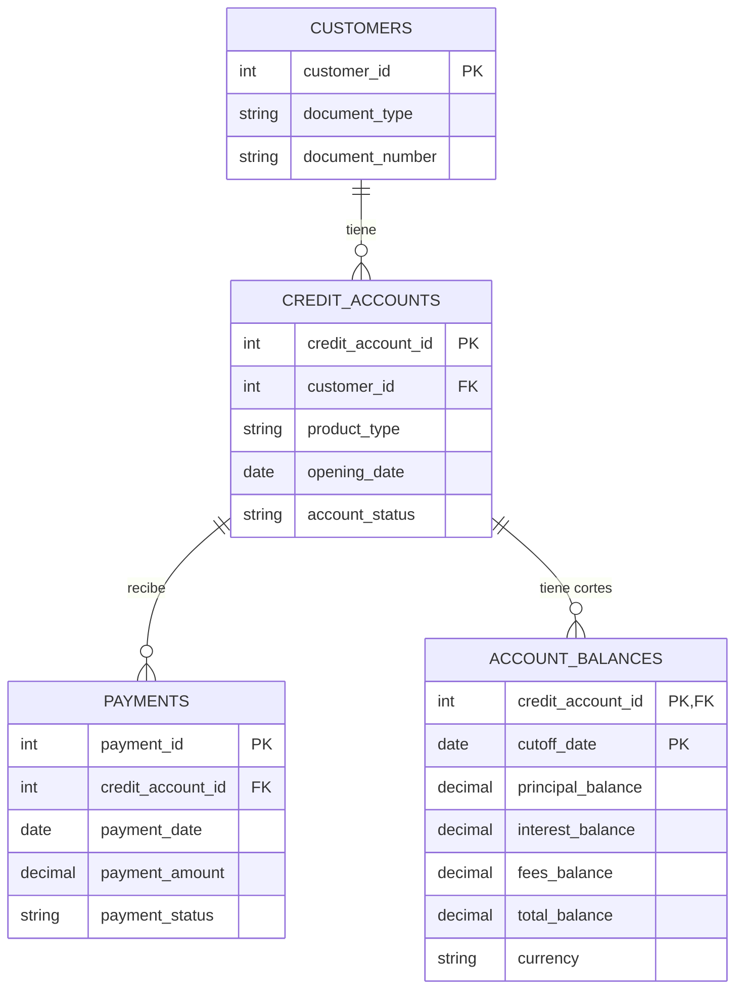

# DataTrust QA

Laboratorio práctico para prepararnos para una entrevista de Analista QA / Datos Jr Plus. El foco es aprender a validar y reconciliar datos con criterio de QA y SQL; Python se usará como apoyo para generar datos sintéticos reproducibles.

> Proyecto educativo con un escenario ficticio. No contiene ni representa datos o procesos internos de una empresa.

## ¿Qué significa “una fila”?

Cada tabla representa un tipo de cosa y cada fila representa **una instancia de esa cosa**. A eso le llamamos granularidad. Acordarla evita comparar peras con manzanas o producir conteos duplicados al relacionar tablas.

- **Cliente:** una fila por cliente.
- **Cuenta de crédito:** una fila por cuenta; cada cuenta pertenece a un cliente.
- **Pago:** una fila por transacción de pago; cada pago corresponde a una cuenta.
- **Saldo:** una fila por cuenta y fecha de corte. La misma cuenta puede aparecer en varias fechas.

Estas granularidades son la propuesta inicial, no reglas de negocio definitivas. También habrá que confirmar qué identifica de forma única a cada entidad y qué excepciones se permiten.

## Modelo relacional propuesto

El diagrama muestra las entidades de negocio, no el diseño final de la base. Más adelante se replicará el mismo modelo lógico en los sistemas simulados A (origen) y B (destino), para poder comparar sus datos.



La clave de `ACCOUNT_BALANCES` es compuesta: cuenta + fecha de corte. Así se permite guardar el saldo de una cuenta en varias fechas, pero no dos saldos para la misma cuenta y fecha.

La base separa los datos en tres esquemas:

- `source_a`: datos de origen válidos.
- `landing_b`: recepción cruda de B. `raw_payload` conserva los valores recibidos como JSON, sin restricciones de negocio ni claves foráneas; los errores de validación se registran antes de aceptar o rechazar cada registro.
- `source_b`: datos de B que pasan las validaciones estructurales. Su modelo y restricciones son iguales a los de A para facilitar la comparación.

Por eso, una fecha mal formada o un estado desconocido se conserva en `landing_b` y no se inserta en las tablas tipadas de `source_b`. Una diferencia que sí es válida según el tipo de dato y las restricciones (por ejemplo, un importe distinto pero positivo) puede llegar a `source_b` para que la reconciliación la encuentre.

## Estructura inicial del repositorio

Esta es la estructura inicial. Algunas carpetas siguen vacías a propósito; agregaremos archivos cuando trabajemos cada etapa. Los datos generados localmente no se subirán al repositorio.

```text
data-trust-qa/
├── README.md
├── .env.example
├── .gitignore
├── .github/
│   └── copilot-instructions.md
├── docs/
│   └── CONTEXT.md
├── database/
│   ├── schemas/
│   │   ├── source_a.sql
│   │   ├── source_b.sql
│   │   └── landing_b.sql
│   └── seed/
├── generator/
│   └── src/
├── data/
│   └── generated/
├── sql/
│   ├── profiling/
│   └── reconciliation/
└── qa/
    ├── test-cases/
    └── results/
```

Los nombres y carpetas se pueden ajustar al implementar cada parte. Los directorios vacíos se mantienen con archivos `.gitkeep`. Los datos generados no incluirán información personal real y están excluidos de Git.

## Preparar PostgreSQL local

1. Crea un rol de PostgreSQL para el proyecto desde una terminal Linux. El sistema pedirá la contraseña sin incluirla en el comando:

   ```bash
   sudo -u postgres createuser --pwprompt datatrust_qa
   sudo -u postgres createdb --owner=datatrust_qa datatrust_qa
   ```

   Este es un **usuario/rol de PostgreSQL**, no un usuario nuevo de Linux. La base queda a nombre del rol del proyecto para que pueda crear en ella los objetos del esquema.

2. Copia `.env.example` como `.env`. El `.env` local está ignorado por Git; conserva en él solo la configuración de tu máquina y no compartas contraseñas.

3. En Bash, carga la configuración y ejecuta los tres esquemas. `psql` no carga archivos `.env` automáticamente; las variables `PG*` de la plantilla son variables estándar de conexión de PostgreSQL. `-W` hace que pida la contraseña:

   ```bash
   cp .env.example .env
   set -a
   source .env
   set +a
   psql -W -v ON_ERROR_STOP=1 -f database/schemas/source_a.sql
   psql -W -v ON_ERROR_STOP=1 -f database/schemas/source_b.sql
   psql -W -v ON_ERROR_STOP=1 -f database/schemas/landing_b.sql
   ```

   Ejecuta estos pasos desde la raíz del repositorio. La plantilla no incluye contraseña; `psql` la solicitará al conectarse. Estos scripts crean objetos nuevos y **no son migraciones idempotentes**: ejecútalos una sola vez por base de datos.

## Plan de trabajo

1. Acordar el escenario y qué se va a comparar entre A y B.
2. Revisar entidades, granularidad, claves y relaciones.
3. Definir reglas de negocio y criterios para decidir qué es un defecto.
4. Diseñar la base y documentar el modelo.
5. Generar con un script reproducible una primera población de aproximadamente **20.000–30.000 registros por sistema** (A y B), distribuidos entre las entidades. El volumen exacto se decidirá al diseñar la generación.
6. Aprender SQL y perfilar los datos válidos antes de introducir defectos.
7. Practicar reconciliación, casos de prueba, evidencia e investigación de diferencias.
8. Aumentar el volumen y estudiar optimización solo cuando las pruebas iniciales estén bien entendidas.

Cada etapa se explicará de forma concreta: qué haremos, por qué importa y cómo sabremos que quedó bien. No se generarán consultas SQL, código o soluciones completas salvo que el usuario lo solicite.

Para más contexto sobre el enfoque y las etapas, consulta [docs/CONTEXT.md](docs/CONTEXT.md).
